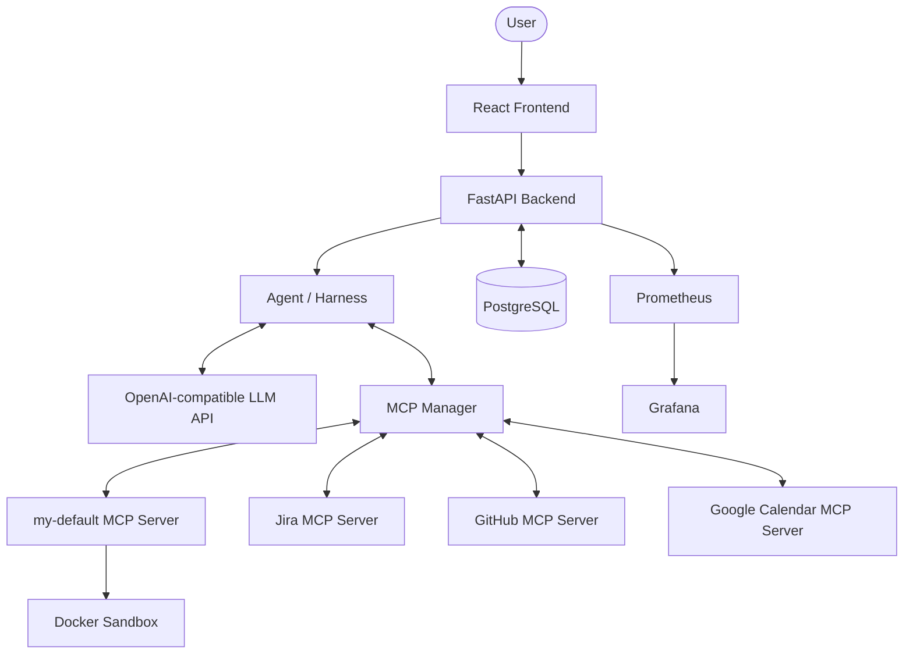

# Workflow Automation Agent

**Workflow Automation Agent** — AI-агент для автоматизации рабочих процессов через взаимодействие с внешними сервисами и инструментами. Пользователь описывает задачу на естественном языке, а агент использует LLM и MCP-инструменты для её выполнения.

Проект объединяет LLM orchestration, интеграции с внешними API, изолированное выполнение пользовательских инструментов и инфраструктуру для развёртывания и мониторинга.

## Возможности

- **AI Agent** — выполнение задач на естественном языке с использованием LLM.
- **Tool Calling** — подключение и вызов инструментов через [Model Context Protocol (MCP)](https://modelcontextprotocol.io/).
- **GitHub Integration** — поиск по коду, чтение файлов и работа с Pull Requests.
- **Jira Integration** — поиск, создание и изменение задач, управление комментариями и статусами.
- **Google Calendar Integration** — поиск событий, просмотр календарей и получение информации о расписании.
- **Custom Tools** — выполнение собственных инструментов в изолированной Docker-песочнице.
- **Conversation History** — сохранение диалогов и трассировок вызовов инструментов.
- **Authentication** — регистрация, авторизация и JWT-аутентификация.
- **Observability** — сбор метрик приложения с помощью Prometheus и Grafana.
- **LLM Security Testing** — конфигурация автоматизированного red teaming с Promptfoo.

## Архитектура

Система состоит из frontend, backend, LLM provider, PostgreSQL и MCP-серверов.



### Компоненты

| Компонент | Назначение |
|---|---|
| Frontend | React-интерфейс для взаимодействия с агентом |
| Backend | FastAPI API, аутентификация, управление диалогами и orchestration |
| Agent / Harness | Управление циклом работы агента и вызовами инструментов |
| MCP Manager | Обнаружение MCP-инструментов и маршрутизация вызовов |
| my-default | Собственный MCP-сервер для пользовательских инструментов |
| Docker Sandbox | Изолированное выполнение инструментов |
| PostgreSQL | Хранение пользователей, диалогов и интеграций |
| Prometheus | Сбор метрик backend |
| Grafana | Визуализация метрик |

MCP Manager загружает конфигурацию серверов из `src/react_agent/backend/mcp/mcp_config.yaml`. Для каждого сервера используются MCP-схемы инструментов, а сами вызовы выполняются через Streamable HTTP.

Собственный сервер `my-default` развёртывается как отдельный Docker Compose service. Он взаимодействует с Docker daemon для запуска изолированных sandbox-контейнеров.

## Технологический стек

| Область | Технологии |
|---|---|
| Backend | Python, FastAPI, SQLAlchemy |
| Frontend | React, JavaScript, Vite |
| LLM | OpenAI-compatible API, OpenAI Python SDK |
| Agent Tools | Model Context Protocol (MCP) |
| Database | PostgreSQL |
| Authentication | JWT, Argon2 |
| Infrastructure | Docker, Docker Compose |
| CI/CD | GitHub Actions, GitHub Container Registry |
| Monitoring | Prometheus, Grafana |
| Security Testing | Promptfoo |
| Python tooling | uv, Ruff, pytest |

## Быстрый запуск

### Требования

- Windows
- [Docker Desktop](https://www.docker.com/products/docker-desktop/)
- API key для OpenAI-compatible LLM provider

Для локальной разработки вне Docker дополнительно потребуются [uv](https://docs.astral.sh/uv/) и [Node.js](https://nodejs.org/).

### 1. Клонирование

```powershell
git clone https://github.com/MegaSear/workflow-automation-agent.git
cd workflow-automation-agent
```

### 2. Конфигурация

Создайте `.env` на основе примера:

```powershell
copy .env.example .env
```

Заполните параметры LLM provider:

```dotenv
LLM_API_KEY=
LLM_BASE_URL=
LLM_MODEL=
```

Укажите секреты для аутентификации и шифрования интеграций:

```dotenv
JWT_SECRET_KEY=
INTEGRATION_ENCRYPTION_KEY=
MY_DEFAULT_MCP_TOKEN=
```

`JWT_SECRET_KEY` должен содержать не менее 32 байт.

Сгенерировать JWT secret можно командой:

```powershell
python -c "import secrets; print(secrets.token_urlsafe(32))"
```

Сгенерировать ключ шифрования интеграций:

```powershell
uv run python -c "from cryptography.fernet import Fernet; print(Fernet.generate_key().decode())"
```

Ключ `INTEGRATION_ENCRYPTION_KEY` необходимо хранить отдельно от резервных копий базы данных: без него зашифрованные credentials нельзя будет расшифровать.

### 3. Google Calendar OAuth

Для интеграции с Google Calendar:

1. Создайте OAuth 2.0 credentials в Google Cloud Console.
2. Поместите файл credentials в `secrets/google_web_credentials.json`.
3. Добавьте redirect URI:

```text
http://localhost:8000/api/integrations/google_calendar/callback
```

### 4. Запуск

```powershell
docker compose up --build -d --wait
```

После запуска сервисы доступны по адресам:

| Сервис | URL |
|---|---|
| Frontend | http://localhost:5173 |
| Backend API | http://localhost:8000 |
| Prometheus | http://localhost:9090 |
| Grafana | http://localhost:3000 |

Для остановки:

```powershell
docker compose down
```

Данные PostgreSQL сохраняются в Docker volume и не удаляются при обычной остановке Compose.

> **Важно:** Backend и `my-default` используют Docker socket для запуска sandbox-контейнеров. Это предоставляет им доступ к Docker daemon. Используйте конфигурацию только на доверенной машине.

## Интеграции

MCP-серверы настраиваются в `src/react_agent/backend/mcp/mcp_config.yaml`.

| Интеграция | Возможности | Авторизация |
|---|---|---|
| GitHub | Чтение файлов, поиск кода, чтение и создание Pull Requests | Personal Access Token |
| Jira | Поиск, создание и изменение задач, комментарии, переходы между статусами | Jira credentials |
| Google Calendar | Просмотр календарей и поиск событий | OAuth 2.0 |
| my-default | Собственные инструменты и файловые операции | Внутренний MCP token |

Секреты интеграций хранятся в базе данных в зашифрованном виде. Для внешних MCP-серверов рекомендуется использовать HTTPS.

## LLM Configuration

Проект использует OpenAI-compatible Chat Completions API, поэтому можно подключать различные совместимые LLM providers.

Основные параметры генерации задаются через `.env`:

| Переменная | Назначение |
|---|---|
| `LLM_MAX_COMPLETION_TOKENS` | Максимальное количество токенов ответа |
| `LLM_TEMPERATURE` | Температура генерации |
| `LLM_TOP_P` | Nucleus sampling |
| `LLM_FREQUENCY_PENALTY` | Штраф за частые повторения токенов |
| `LLM_PRESENCE_PENALTY` | Штраф за повторное использование токенов |
| `LLM_SEED` | Seed генерации |
| `LLM_REASONING_EFFORT` | Уровень reasoning effort, если поддерживается провайдером |

Доступность параметров зависит от конкретной модели и LLM provider.

GitHub MCP использует allowlist инструментов для ограничения доступного набора и снижения расхода токенов. История чата также ограничивается по размеру.

## Production Deployment

Для production-развёртывания предусмотрен отдельный `docker-compose.prod.yml`.

Вместо локальной сборки используются Docker images из GitHub Container Registry:

- `ghcr.io/megasear/workflow-automation-agent-backend`
- `ghcr.io/megasear/workflow-automation-agent-frontend`
- `ghcr.io/megasear/workflow-automation-agent-my-default`
- `ghcr.io/megasear/workflow-automation-agent-sandbox`

Перед запуском production-конфигурации настройте `.env` и укажите `FRONTEND_URL`.

Развёртывание конкретной версии:

```powershell
.\scripts\deploy.ps1 -ImageTag <image-tag>
```

Скрипт загружает образы с указанным тегом и запускает production Compose stack.

## CI/CD

GitHub Actions выполняет автоматические проверки при Push и Pull Request.

Pipeline включает:

1. **Backend Unit Tests** — Ruff и pytest на Python 3.11–3.14.
2. **Backend Integration Tests** — интеграционные тесты с Docker sandbox.
3. **Frontend Checks** — Prettier, ESLint и production build.
4. **Docker Build** — сборка всех Docker images.
5. **Publish** — публикация образов в GHCR после успешных проверок при Push в `master` или создании version tag.

Для образов публикуются SHA-based tags, а для `master` также обновляется `latest`.

## Тестирование

Запуск backend-тестов:

```powershell
uv run pytest
```

Только unit-тесты:

```powershell
uv run pytest tests/unit
```

Интеграционные тесты:

```powershell
uv run pytest tests/integration -v
```

Проверка Python-кода:

```powershell
uv run ruff check .
```

## LLM Security Testing

В репозитории присутствует конфигурация [Promptfoo](https://www.promptfoo.dev/) для автоматизированного red teaming.

В `promptfooconfig.yaml` настроен target локального backend API и набор проверок, включающий:

- Prompt hijacking;
- Excessive agency;
- PII exposure;
- Harmful cybercrime requests.

Для запуска необходимо предварительно получить JWT и передать его через переменную окружения `REACT_AGENT_JWT`.

```powershell
$env:REACT_AGENT_JWT = "<your-jwt-token>"
npx promptfoo redteam run
```

Результаты проверок позволяют выявлять потенциальные уязвимости в поведении агента и его взаимодействии с инструментами.

## Локальная разработка

Backend:

```powershell
uv sync
uv run uvicorn react_agent.backend.api.server:app --reload
```

Frontend:

```powershell
cd src/react_agent/frontend
npm install
npm run dev
```

Для локальной разработки без Docker необходимо самостоятельно обеспечить доступность PostgreSQL и MCP-сервисов, настроить переменные окружения и конфигурацию интеграций.

## Лицензия

Проект распространяется под лицензией [Apache License 2.0](LICENSE).

---

**Repository:** [MegaSear/workflow-automation-agent](https://github.com/MegaSear/workflow-automation-agent)